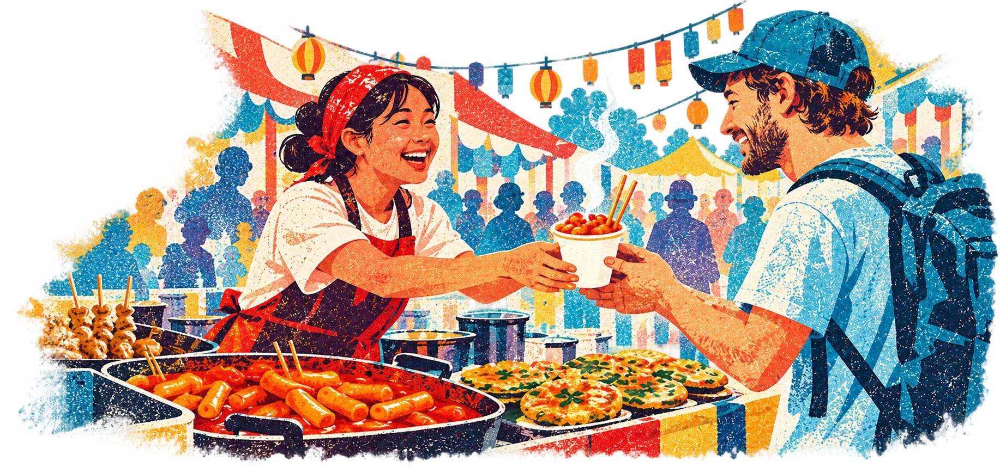
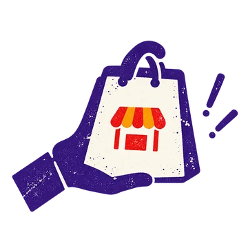
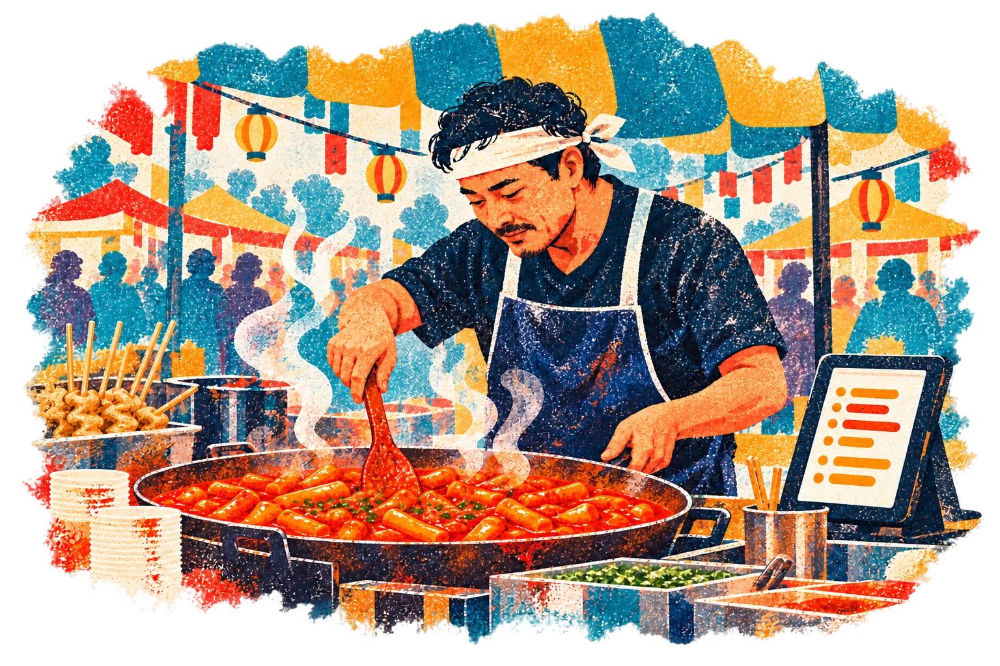
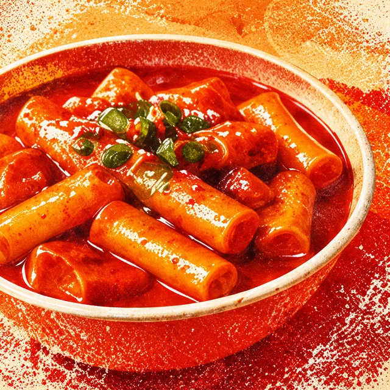

<h1 align="center">BoothBites</h1>

<p align="center">
  <strong>말은 달라도, 축제의 맛은 함께.</strong><br/>
  작은 축제 부스와 세계의 여행자를 잇는 QR 음식 주문 서비스
</p>

<p align="center">
  
</p>

<p align="center">음식 사진으로 한·영 메뉴 초안을 만들고, QR 주문부터 픽업까지 연결합니다.<br/><sub>실제 결제 없는 체험 데모 · 한국어 / English · 손님 앱 설치 불필요</sub></p>

## 축제를 즐기러 왔는데, 주문 앞에서 멈추지 않도록

축제 음식 부스에서는 사장님이 요리를 하다가 주문을 받고 계산까지 해야 합니다. 외국인 여행자는 낯선 메뉴를 이해하고 한국어로 주문할 말을 찾습니다. BoothBites는 이 과정에서 생기는 번거로움을 줄여보자는 생각에서 시작했습니다.

사장님은 메뉴를 등록해 부스 QR을 공개하고, 손님은 자신의 휴대폰에서 음식을 고릅니다. 주문은 사장님 화면에 한국어로 도착하고, 손님은 픽업 티켓으로 준비 상태를 확인합니다.

## 메뉴 공개부터 픽업까지

| 1. 메뉴 공개 | 2. QR 주문 | 3. 조리 | 4. 픽업 |
| :---: | :---: | :---: | :---: |
|  |  |  |  |
| 사진·설명·가격을<br/>확인하고 공개 | 한국어·영어로 메뉴를<br/>보고 수량을 선택 | 한국어로 주문을 받고<br/>조리 상태 변경 | 준비 완료를 확인하고<br/>주문번호로 수령 |

## 부스 양쪽에서 달라지는 경험

<table>
  <tr>
    <th width="50%">사장님은 요리에 더 집중하세요.</th>
    <th width="50%">여행자는 한 입 더 가까이.</th>
  </tr>
  <tr>
    <td align="center"></td>
    <td align="center"></td>
  </tr>
  <tr>
    <td valign="top">
      <ul>
        <li>AI가 제안한 한·영 메뉴명과 소개를 확인해 등록합니다.</li>
        <li>사진과 가격이 담긴 메뉴를 부스 전용 QR로 공유합니다.</li>
        <li>손님이 영어로 고른 음식도 한국어 주문으로 받습니다.</li>
        <li>남은 수량·품절·접수 중단과 조리 상태를 관리합니다.</li>
      </ul>
    </td>
    <td valign="top">
      <ul>
        <li>사진과 한·영 설명으로 낯선 음식을 알아보고 고릅니다.</li>
        <li>앱 설치 없이 QR을 열어 메뉴와 수량을 선택합니다.</li>
        <li>픽업 티켓에서 접수·조리·준비 완료 상태를 확인합니다.</li>
        <li>음식이 준비되면 부스에서 주문번호를 보여줍니다.</li>
      </ul>
    </td>
  </tr>
</table>

## 메뉴 소개를 고민하는 시간도 줄이도록

음식 사진이나 메뉴판을 올리면 Claude가 한국어·영어 메뉴 초안을 제안합니다. 사진을 보며 메뉴가 제대로 등록됐는지 확인하고, 이름과 소개를 손님에게 보여주기 전에 다듬을 수 있습니다.

| 올리는 사진 | AI가 제안하는 초안 | 사장님이 확인할 내용 |
| --- | --- | --- |
| 음식만 찍은 사진 | 추정 메뉴명과 보이는 특징을 바탕으로 한 소개 | 실제 음식명·설명, 직접 입력할 가격 |
| 글자가 적힌 메뉴판 | 메뉴판에 적힌 이름·가격·설명을 읽은 한·영 초안 | 인식 결과와 가격의 정확성 |

랜딩페이지에서 보여주는 메뉴 소개 예시입니다.

| 메뉴판에 적힌 정보 | 다듬은 소개 예시 |
| --- | --- |
| 쫄깃한 쌀떡 · 매콤달콤 소스 · 1컵 | **매콤달콤 쌀떡볶이**<br/>쫄깃한 쌀떡에 매콤달콤한 소스를 더한 한 컵. 축제에서 즐겨보세요. |

AI 결과는 판매자가 확인한 뒤 공개합니다. 원재료·알레르기·식이 안전 정보는 사진으로 추정하지 않습니다. AI 연결 없이도 직접 입력하거나 사진이 포함된 예시 메뉴를 불러와 주문 흐름을 체험할 수 있습니다.

## 프로젝트 범위

한국 지역 축제의 음식 부스를 대상으로 만든 해커톤 프로젝트입니다. 메뉴 등록·공개, QR 안내판, 한·영 주문과 조리·픽업 상태 관리를 구현했습니다.

결제는 실제 카드 정보를 받지 않는 모의 결제입니다. 예시 메뉴·부스·이미지는 시연용이며, 실제 축제에서의 사용자 테스트나 대기 시간 감소 효과는 아직 측정하지 않았습니다. 픽업 상태는 페이지가 열려 있을 때 갱신됩니다.

## 이미지와 서체

README에는 서비스 랜딩페이지의 판화풍 일러스트를 사용했습니다. 음식 사진·생성 이미지의 출처와 사용 조건은 [이미지 출처](docs/asset-sources.md), 한글 서체 정보는 [랜딩페이지 서체](docs/landing-font-source.md)에 정리되어 있습니다. 음식 사진의 크레딧은 앱 하단에서도 확인할 수 있습니다.

<details>
<summary>개발자를 위한 실행 방법과 구현 상세</summary>

## 기술 구성

| 영역 | 사용 기술 |
| --- | --- |
| 화면 | React · TypeScript · Vinext |
| 서버 실행 | Cloudflare Workers |
| 데이터·사진 | Cloudflare D1 · R2 |
| AI 메뉴 초안 | Claude 이미지 입력 · 구조화 응답 |
| 배포 | ChatGPT Sites |

<details>
<summary>주문 처리와 권한 설계</summary>

- 한국어·영어 메뉴, 분류 필터, 장바구니, 모의 결제 성공·실패 시연
- 주문 접수·조리·픽업·수령 상태, 품절, 접수 중단, 동시 조리 한도
- 가격은 서버 메뉴에서 계산하며 주문 시점의 메뉴 정보를 보존
- 리비전 비교 갱신으로 동시 주문의 재고·조리 한도 경쟁을 처리
- 주문 재시도 중복 방지, 관리 토큰 검증, 주문별 영수증 토큰
- 새로고침 후 미완료 요청 복구, 여러 주문의 픽업 티켓 선택
- 메뉴 사진 업로드, 판매자 확인, QR PNG 저장과 인쇄 안내판

</details>

## 로컬에서 실행하기

Node.js 22.13 이상이 필요합니다.

```powershell
npm ci
npm run build
node --import ./scripts/sites-env.mjs ./node_modules/wrangler/bin/wrangler.js d1 execute DB --local --config dist/server/wrangler.json --persist-to .wrangler/state --file drizzle/0000_overconfident_gauntlet.sql
node --import ./scripts/sites-env.mjs ./node_modules/wrangler/bin/wrangler.js d1 execute DB --local --config dist/server/wrangler.json --persist-to .wrangler/state --file drizzle/0001_outstanding_franklin_richards.sql
npm run dev
```

SQL 명령은 새 로컬 DB에서 각각 한 번만 실행합니다. 기존 DB에는 아직 적용하지 않은 마이그레이션만 실행합니다. 서버 주소는 `http://127.0.0.1:5173`입니다.

- `/`: 발표용 서비스 소개 랜딩페이지
- `/demo`: 이 브라우저의 데모 부스 손님 화면
- `/studio`: 같은 부스의 주문 현황·메뉴 관리·QR 안내판
- `/b/{id}`: QR로 공유하는 부스 메뉴

<details>
<summary>AI 설정과 호출 제한</summary>

서버의 `ANTHROPIC_API_KEY`가 설정되면 Claude가 음식 사진 또는 메뉴판을 구분해 한영 메뉴 초안을 만듭니다. 음식 사진은 추정 메뉴명과 보이는 특징을 바탕으로 소개를 제안하고 가격은 비워둡니다. 글자가 있는 메뉴판은 적힌 이름·가격·설명을 읽습니다. `ANTHROPIC_MODEL`은 선택 사항이며 기본값은 `claude-sonnet-5-5`입니다. [Claude 이미지 입력](https://platform.claude.com/docs/en/build-with-claude/vision)과 [구조화 응답](https://platform.claude.com/docs/en/build-with-claude/structured-outputs)을 사용합니다.

로컬은 무시되는 `.dev.vars`에 키를 설정하고 서버를 다시 시작합니다. 호스팅에서는 Sites의 서버 환경변수 관리로 비밀 값을 등록합니다. 브라우저에 키를 넣지 마세요.

공개 데모는 사이트 전체 하루 50회까지 AI를 호출합니다. 한국 시간 자정에 초기화하며 실패한 호출도 포함합니다. 서버의 `AI_DAILY_LIMIT`으로 1~1000회 범위에서 조정할 수 있습니다. 잘못된 이미지나 관리 권한이 없는 요청은 호출 전에 차단합니다. Sonnet 5.5는 도구 없는 메뉴 인식에서 사전 추론을 끄고 실제 결과에 출력 한도를 사용합니다. 응답 길이 제한에 걸리면 한 번만 한도를 늘려 재시도하며, 이 호출도 일일 한도에 포함합니다. 두 시도에는 45초의 공통 제한을 적용합니다.

키가 없으면 AI 버튼이 비활성화되며 직접 입력과 예시 메뉴 불러오기를 사용할 수 있습니다. 예시 메뉴를 사진 인식 결과로 표시하지 않습니다. 원재료·알레르기·식이 안전은 AI가 추정하지 않으며 판매자가 확인한 정보만 표시합니다. 음식 사진은 R2에 저장되고 메뉴에 연결됩니다. 공개 전 사진은 관리 권한으로만 읽을 수 있고, 메뉴를 공개한 뒤에는 손님도 볼 수 있습니다. 메뉴가 아닌 사진·응답 중단·응답 형식 오류는 서로 다른 안내를 표시합니다.

</details>

## 검증

```powershell
npm run typecheck
npm test
# 개발 서버를 실행한 상태에서
npm run test:api
```

단위 테스트는 가격·재고·중복 주문·조리 한도·취소 복구·공개 데이터 범위, Claude 요청 형식·실패 응답·잘못된 초안 차단·AI 일일 한도를 확인합니다. API 테스트는 실제 로컬 D1에서 마지막 재고 동시 주문, 관리 권한, 영수증 접근, 상태 전환, 접수 중단, 메뉴 변경 충돌을 검증합니다. 테스트는 독립된 데모 부스를 생성합니다.

## 데모 범위

- 결제는 **자체 모의 결제**입니다. PG 샌드박스 또는 실제 해외카드 결제 연동은 아직 하지 않았습니다. 실제 카드 정보는 받지 않습니다.
- Claude 실제 이미지 호출로 글자가 있는 메뉴판의 가격·한영 초안과 타코야끼 음식 사진의 메뉴명·소개 생성을 확인했습니다. AI 결과는 원문과 다를 수 있으므로 판매자 확인이 필요합니다.
- 브라우저 자동화가 실행 환경에서 중단되어 렌더링·모바일 조작 검증은 미완료입니다.
- 상태 갱신은 열린 페이지에서 주기적으로 수행합니다. 백그라운드 푸시 알림이나 SMS는 없습니다.
- 수량 선택을 지원합니다. 조리 방식 선택이나 유료 추가 옵션은 아직 없습니다.
- 메뉴·축제·부스·사진은 시연용입니다. 사용자 테스트나 대기 시간 개선을 측정하지 않았습니다.
- 부스당 200개 주문까지인 데모 모델입니다. 운영용 인증·결제/환불·가맹점 정산·대규모 부하 대응을 대체하지 않습니다.

</details>
